<p align="center">
  
</p>

<p align="center">
  <a href="https://omarchy.org"></a>
  <a href="https://hyprland.org"></a>
  <a href="https://quickshell.org"></a>
  
  <a href="LICENSE"></a>
  
  
</p>

<p align="center">
  <a href="#what-it-is">What it is</a> .
  <a href="#features">Features</a> .
  <a href="#how-it-works">How it works</a> .
  <a href="#ring-states">Ring states</a> .
  <a href="#install">Install</a> .
  <a href="#configuration">Config</a> .
  <a href="#troubleshooting-and-offline-behaviour">Troubleshooting</a> .
  <a href="#roadmap">Roadmap</a> .
  <a href="#credits">Credits</a>
</p>

> **Larry is Nix's persistent AI co-worker. The lamp is Larry's body. This widget puts that body on your bar.**


## What it is

**Larry Lamp** is an Omarchy bar widget for Larry's [Autonomous Lamp](https://www.autonomous.ai/lamp), a desk lamp with servos, a voice and an LED ring. One glance at your bar tells you three things:

- **What colour the lamp's ring is right now.** Not a guess, not a theme colour. The real hex, breathing when the lamp breathes.
- **Which Claude Code session needs you.** An amber count lights up the moment a session is waiting on you.
- **What Larry just said.** And a box to say something back.

Click it and you get the panel: every session, Larry's last words, an ask-Larry box and the lamp's controls. It talks to the lamp HAL on `:5001` and the larry-lamp broker on `:5055/larry` by default, and when either one is gone it degrades quietly instead of freezing your bar.

<p align="center">
  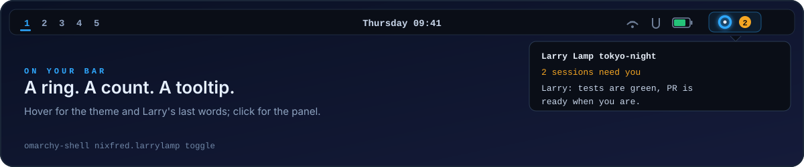
</p>

## Meet the body

<p align="center">
  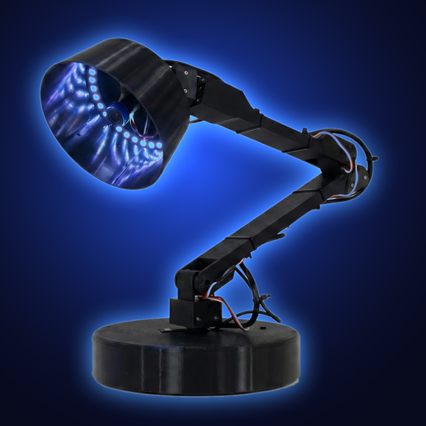
</p>

<table>
  <tr>
    <td width="50%">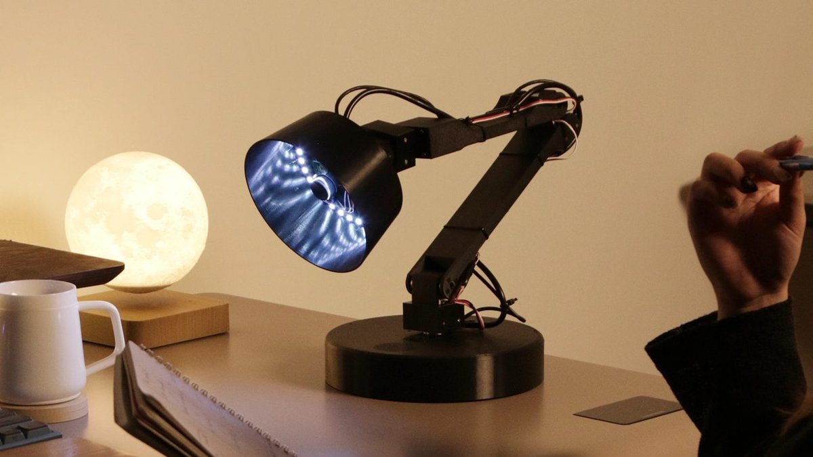</td>
    <td width="50%">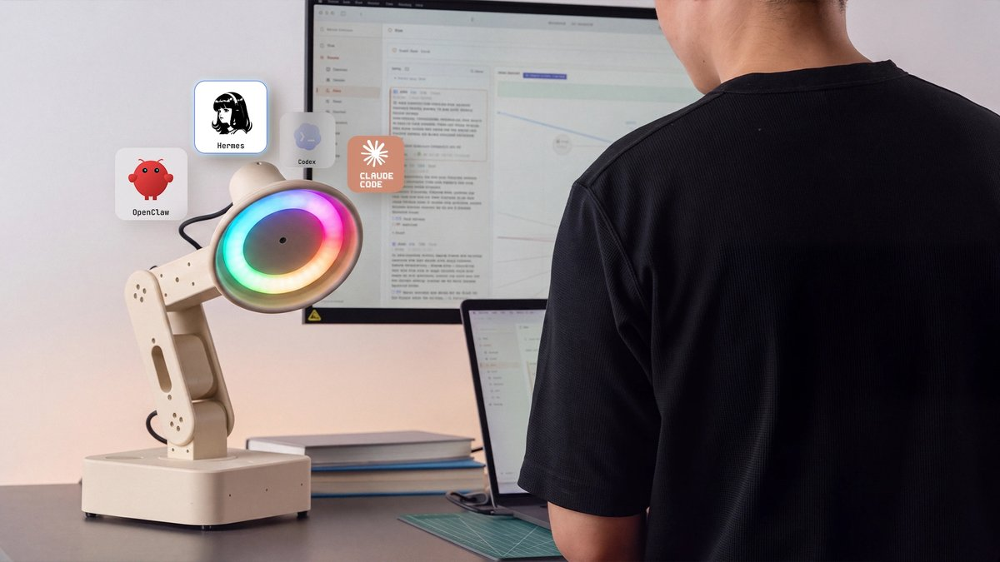</td>
  </tr>
  <tr>
    <td>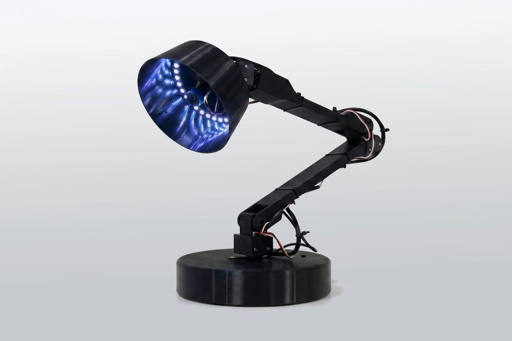</td>
    <td>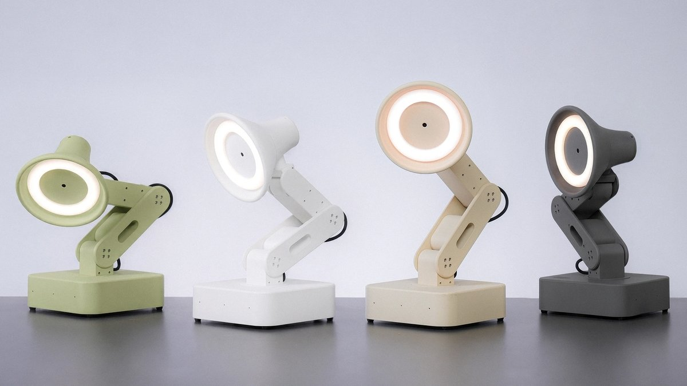</td>
  </tr>
  <tr>
    <td>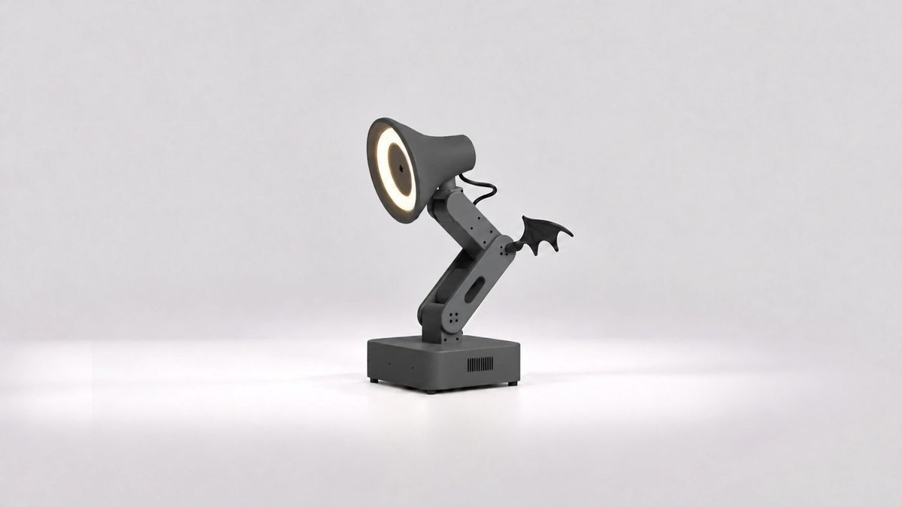</td>
    <td>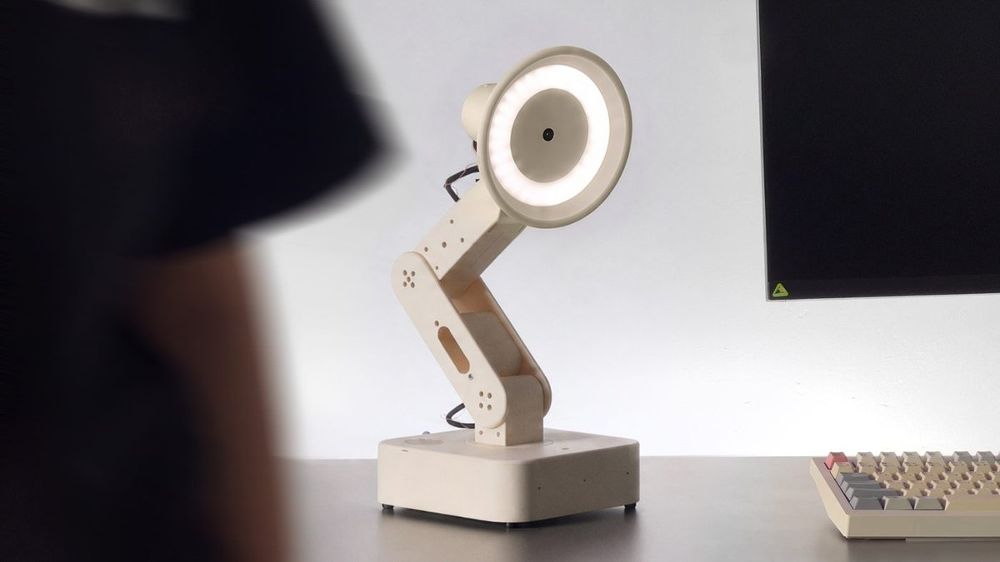</td>
  </tr>
</table>

<p align="center"><sub>Product photos courtesy of Autonomous (<a href="https://www.autonomous.ai/lamp">autonomous.ai/lamp</a>).</sub></p>


## Features

<table>
  <tr>
    <td>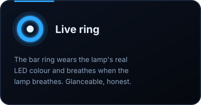</td>
    <td>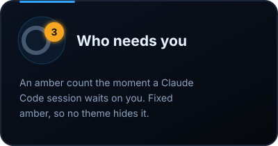</td>
    <td>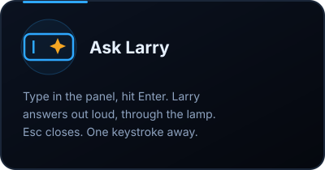</td>
  </tr>
  <tr>
    <td>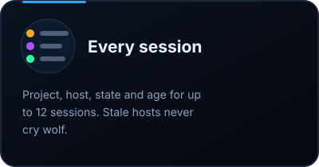</td>
    <td>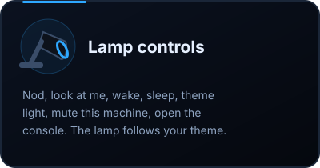</td>
    <td>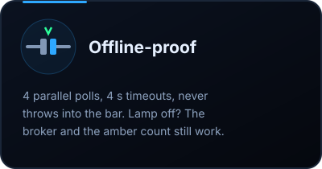</td>
  </tr>
</table>

- **Zero dependencies.** The backend is one file of python3 standard library. No pip, no venv, no daemon of its own.
- **Never blocks the bar.** State arrives as one JSON line every N seconds from a child process. Actions run as one-shot processes with an argv list, never through a shell.
- **Theme aware.** The lamp follows your Omarchy theme, and the **theme light** button snaps the ring to the current theme accent.
- **One plugin, every machine.** Point each machine at the same lamp with one URL and they all share the same body.


## How it works

<p align="center">
  
</p>

**Signals in.** Claude Code hooks report every session's state to the larry-lamp broker: thinking, waiting on you, done, failed, idle. Omarchy hooks report theme changes and lock / unlock, so the lamp can wear your palette and know when you are away.

**Brain.** The broker keeps the session list and host heartbeats, marks hosts that went quiet as stale, and handles ask-Larry. The arbiter is the one voice for the ring: many things want the lamp at once, and the arbiter decides what it actually shows.

**Body.** The lamp HAL (hardware abstraction layer) moves the servos, lights the LED ring and speaks.

**Your bar.** Four small files:

| File | Job |
| --- | --- |
| [`BarWidget.qml`](BarWidget.qml) | The ring on the bar, in the colour the lamp's LED ring shows right now, plus the amber "needs you" badge and the tooltip. |
| [`LampPanel.qml`](LampPanel.qml) | Click the ring. Sessions, Larry's last words, the ask box, lamp controls. Everything on one screen; only the session list scrolls. |
| [`Service.qml`](Service.qml) | Runs `larrylamp.py watch`, keeps its latest JSON line, respawns it if it dies, runs actions as one-shot processes. |
| [`larrylamp.py`](larrylamp.py) | python3 stdlib. Polls the HAL and the broker **in parallel** (4 s timeout each) and never raises into the bar. |
| [`manifest.json`](manifest.json) | Plugin id `nixfred.larrylamp`, the bar widget entry and its one setting. |

Every refresh is four GETs at once:

| Request | Gives the widget |
| --- | --- |
| `GET {HAL}/led/color` | the ring: `on`, `hex`, `effect` (and whether the lamp answers at all) |
| `GET {broker}/sessions` | every Claude Code session, its host, state, age and staleness |
| `GET {broker}/omarchy` | the theme name, its accent colour, and whether the screen is locked |
| `GET {HAL}/voice/last-spoken` | what Larry last said |


## Ring states

<p align="center">
  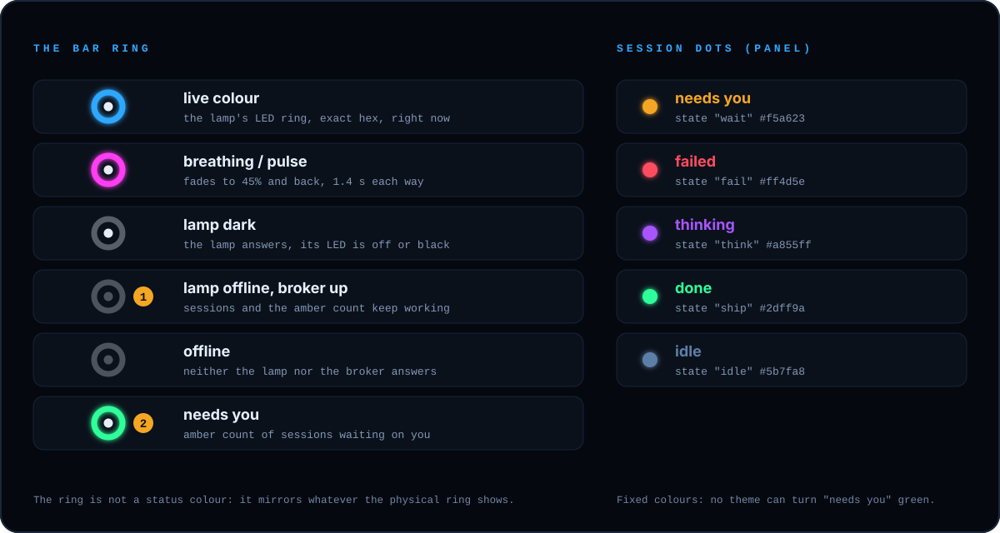
</p>

The bar ring is a **mirror, not a status light**: it shows whatever the physical ring shows. Here is how to read it.

| On the bar | Means |
| --- | --- |
| Ring in a colour, solid | The lamp's LED ring is that exact colour right now. |
| Ring fading to 45% and back (1.4 s each way) | The lamp is breathing or pulsing. |
| Ring faint (35%), lens bright | The lamp answers, but its LED is off or black. |
| Ring and lens faint (30%), amber badge still counting | The lamp is not answering, the broker is up. Sessions still work. |
| Ring and lens faint (30%), no badge | Offline: neither the lamp nor the broker answers. |
| Amber badge with a number | That many sessions are waiting on you. The widget widens to fit it. |

In the panel every session gets a dot. These colours are **fixed on purpose**: some themes map "urgent" to green, and "needs you" should never look like "done".

| Dot | State | Means |
| --- | --- | --- |
|  | `wait` | needs you |
|  | `fail` | failed |
|  | `think` | thinking |
|  | `ship` | done |
|  | `idle` | idle |

### Who matters most

<p align="center">
  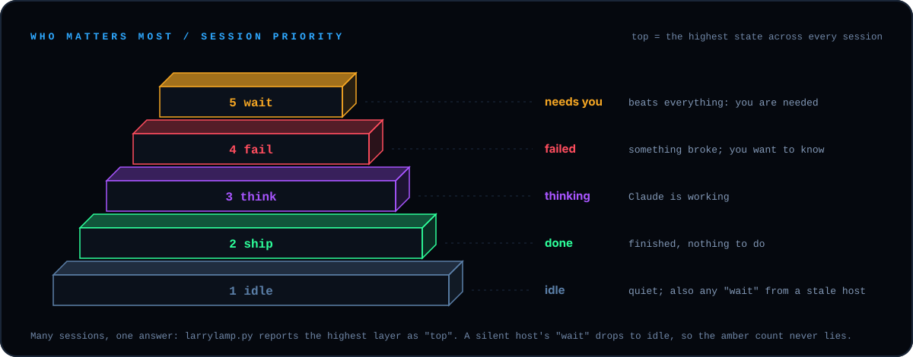
</p>

With many sessions running, `larrylamp.py` ranks them `wait > fail > think > ship > idle` and reports the winner as `top`. A session stuck on "wait" from a host that stopped heartbeating is shown as idle, so the amber count only counts sessions that can actually still need you.


## The panel

<p align="center">
  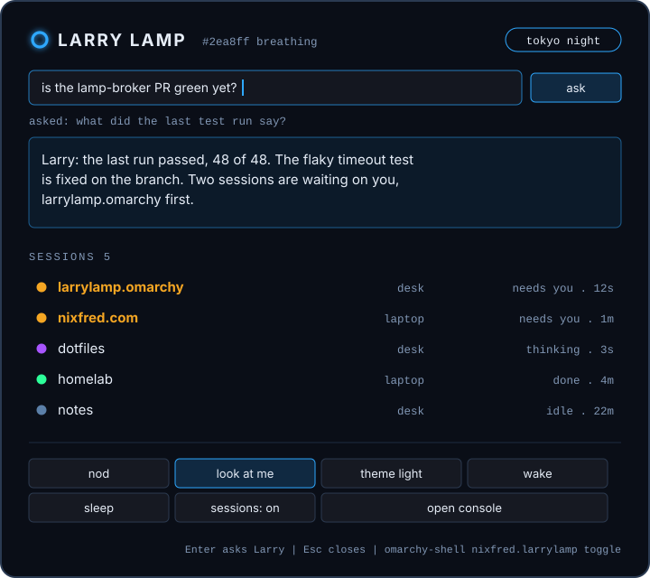
</p>

| Control | What happens |
| --- | --- |
| **ask** (or Enter) | Sends your text to Larry through the broker (up to 1000 chars). Larry answers out loud through the lamp. |
| **nod** | The lamp nods. |
| **look at me** | The head turns to you. |
| **theme light** | The ring goes to the current Omarchy theme accent. |
| **wake** | The greeting motion. |
| **sleep** | The sleepy motion, then the light goes off. |
| **sessions: on / muted** | Whether this machine's Claude Code sessions drive the lamp. Muting creates `~/.config/larry-lamp/disabled`. |
| **open console** | Opens the lamp's web console (`{HAL}/static/larry-lamp.html`) in your browser. |

Open the panel from anywhere, a keybinding or a script:

```bash
omarchy-shell nixfred.larrylamp toggle
```


## Install

<p align="center">
  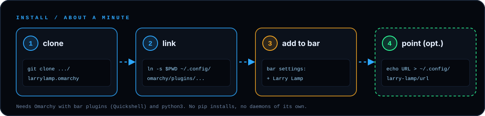
</p>

**You need:** Omarchy with bar plugins (Quickshell), `python3`, and a lamp HAL plus larry-lamp broker somewhere you can reach. Nothing to pip install.

```bash
# 1. clone
git clone https://github.com/nixfred/larrylamp.omarchy.git ~/src/larrylamp.omarchy

# 2. link it in as nixfred.larrylamp (or copy the folder there)
mkdir -p ~/.config/omarchy/plugins
ln -s ~/src/larrylamp.omarchy ~/.config/omarchy/plugins/nixfred.larrylamp

# 3. open the Omarchy bar settings and add "Larry Lamp" (category AI)

# 4. optional: point it at a lamp that is not on this machine
mkdir -p ~/.config/larry-lamp
echo "https://your-lamp.example" > ~/.config/larry-lamp/url
```

It lands on the right side of the bar by default. Update later with `git -C ~/src/larrylamp.omarchy pull`.


## Configuration

<p align="center">
  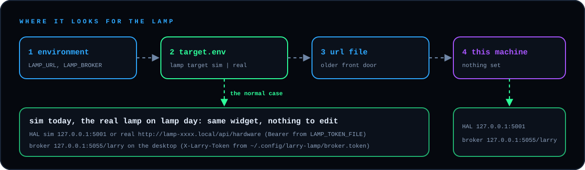
</p>

| Setting | Where | Default | Notes |
| --- | --- | --- | --- |
| `LAMP_URL` | environment of the shell | unset | One URL that serves the HAL at `/` and the broker at `/larry`. Wins over everything. |
| `~/.config/larry-lamp/url` | file, first line | missing | Same as `LAMP_URL`. Easier than env vars, since the bar has to see them. |
| HAL | built in | `http://127.0.0.1:5001` | Used when no URL is set. |
| Broker | built in | `http://127.0.0.1:5055/larry` | Used when no URL is set. |
| **Refresh (seconds)** `intervalSec` | Omarchy bar settings | `2` | 1 to 30. Changing it restarts the watcher. |
| `~/.config/larry-lamp/disabled` | flag file | absent | Present = this machine's sessions do not drive the lamp. The panel button toggles it. |

A front door URL is anything that routes `/` to the HAL and `/larry` to the broker: a reverse proxy, `tailscale serve`, whatever you like. Set it once per machine and every bar talks to the same lamp.

### The state line

The widget's whole world is one JSON line. Run the backend by hand to see it:

```bash
python3 ~/.config/omarchy/plugins/nixfred.larrylamp/larrylamp.py watch --interval 2
```

```json
{
  "online": true,
  "broker": true,
  "led": { "on": true, "hex": "#2ea8ff", "effect": "breathing" },
  "sessions": [
    { "project": "larrylamp.omarchy", "host": "desk", "state": "wait", "age": 12 },
    { "project": "dotfiles", "host": "laptop", "state": "think", "age": 3 }
  ],
  "top": "wait",
  "waiting": 1,
  "theme": "tokyo-night",
  "accent": "#7aa2f7",
  "locked": false,
  "said": "Tests are green, the PR is ready when you are.",
  "saidSeq": 42,
  "hooks": true,
  "console": "http://127.0.0.1:5001/static/larry-lamp.html",
  "t": 1792064460
}
```

`online` means the lamp (HAL) answered. `broker` means the broker answered. Either can be down alone. At most 12 sessions are shown and `said` is capped at 160 characters.

### Actions from the command line

Everything the panel does, you can script:

```bash
L=~/.config/omarchy/plugins/nixfred.larrylamp/larrylamp.py
python3 $L act nod
python3 $L act look
python3 $L act wake
python3 $L act sleep
python3 $L act theme-light
python3 $L act ask "what is waiting on me?"
python3 $L act say "build is green"      # the lamp says it out loud (up to 600 chars)
python3 $L act hooks-off                 # mute this machine's sessions
python3 $L act hooks-on
```

Each prints `{"ok": true}` or `{"ok": false}` and exits.


## Troubleshooting and offline behaviour

Larry Lamp is built to fail quietly. The four requests run in parallel with a 4 second timeout each, so a lamp that does not answer costs one timeout per refresh, not four in a row. Nothing ever raises into the bar, and if the watcher dies, the service starts it again after 3 seconds.

| You see | Likely cause | Try |
| --- | --- | --- |
| Faint ring, tooltip says **offline** | Nothing answers at the URL in use | `curl -s http://127.0.0.1:5001/led/color` and `curl -s http://127.0.0.1:5055/larry/sessions` (or your front door URL). Check `LAMP_URL` and `~/.config/larry-lamp/url` for typos. |
| Faint ring, tooltip says **the lamp is not answering (broker is up)** | The lamp is off, asleep, rebooting or not delivered yet | Sessions and the amber count keep working. Power the lamp and wait one refresh. |
| `LAMP_URL` set in your terminal but ignored | The bar does not inherit your terminal's environment | Put the URL in `~/.config/larry-lamp/url` instead. |
| Ring faint but tooltip shows the theme | The lamp answers, its LED is off or black | Hit **wake** or **theme light** in the panel. |
| Amber count lower than the sessions you see waiting | Those sessions come from a host that stopped heartbeating | Stale hosts never count as "needs you". Check that the host is up and its hooks still run. |
| This machine's sessions never move the lamp | Sessions are muted here | The panel shows **sessions: muted**. Click it, or `rm ~/.config/larry-lamp/disabled`. |
| Widget missing from bar settings | The plugin folder is not where Omarchy looks | The link must be `~/.config/omarchy/plugins/nixfred.larrylamp` and point at the folder holding `manifest.json`. |
| Something else | | Run `larrylamp.py watch` by hand (above) and read the JSON. The service also logs the script's stderr with the prefix `larrylamp:`. |


## Under the hood of the lamp

<table>
  <tr>
    <td width="33%">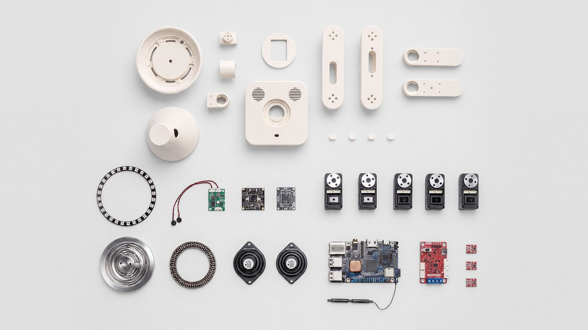</td>
    <td width="33%">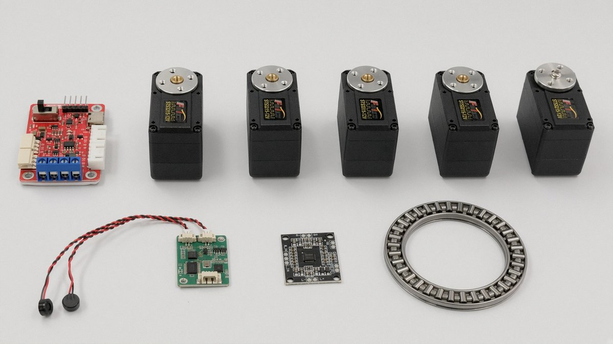</td>
    <td width="33%">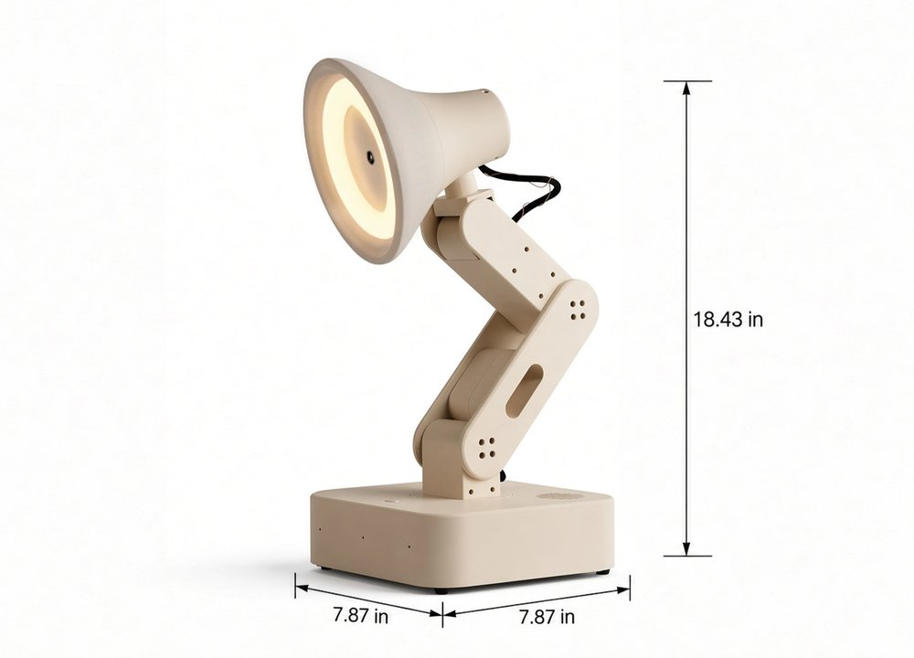</td>
  </tr>
</table>

<p align="center"><sub>Product photos courtesy of Autonomous (<a href="https://www.autonomous.ai/lamp">autonomous.ai/lamp</a>).</sub></p>

## Roadmap

On the bench, not promises:

- [x] Live ring colour on the bar, breathing included
- [x] Amber "needs you" count with stale-host filtering
- [x] Panel: sessions, Larry's last words, ask box, controls
- [x] Lamp vs broker status, parallel polling, no bar stalls
- [ ] Click a session to jump to its terminal
- [ ] Mute a single session, not just a whole machine
- [ ] Desktop notification when a session flips to "needs you"
- [ ] Scrollback of what Larry said today
- [ ] Shapes as well as colours for the session states
- [ ] Pick a ring colour straight from the panel

Ideas welcome: open an issue.

## Credits

- **The lamp:** [Autonomous Lamp](https://www.autonomous.ai/lamp) by Autonomous. Product photos courtesy of Autonomous (autonomous.ai/lamp).
- **The desktop:** [Omarchy](https://omarchy.org), on [Hyprland](https://hyprland.org), with a [Quickshell](https://quickshell.org) bar.
- **The sessions:** [Claude Code](https://www.anthropic.com/claude-code) hooks.
- **Larry:** Nix's persistent AI co-worker, who lives in the lamp.
- **Built by** [Nix](https://nixfred.com) ([@nixfred](https://github.com/nixfred)).

All graphics in `assets/` (everything except `assets/photos/`) are hand-written SVG made for this repo.

## License

MIT, see [LICENSE](LICENSE).

<p align="center">
  
  <br>
  <sub>Made for a lamp with a soul, on linux.</sub>
</p>
