  

  
  
  
  
  

# Larry Lamp for Omarchy

Bar widget for Larry's Autonomous Lamp: a ring lit in the lamp's real LED colour (breathing when it
breathes), an amber count when a Claude Code session needs you, and a panel with every session,
Larry's last words, an ask-Larry box and lamp controls. The lamp itself follows your Omarchy theme.

## How it fits together

  

- **BarWidget.qml**: the ring on the bar, in the colour the lamp's LED ring shows right now, plus an
  amber badge with the number of sessions waiting on you.
- **LampPanel.qml**: click the ring. Sessions, what Larry last said, an ask box, nod / look / wake /
  sleep / theme light, mute this machine's sessions, open the console.
- **Service.qml**: runs `larrylamp.py watch` and keeps its latest JSON line. Actions run as one-shot
  processes with an argv list, never through a shell, so a slow lamp never blocks the bar.
- **larrylamp.py**: python3 standard library only. Polls the lamp HAL and the session broker in
  parallel and never raises into the bar. The bar tells "lamp not answering" apart from "nothing
  answering", so sessions keep working while the lamp is off.

## Where it looks for the lamp

1. `LAMP_URL`, or the first line of `~/.config/larry-lamp/url`: one URL that serves the lamp HAL at
   `/` and the broker at `/larry` (for example a `tailscale serve` front door), so the same plugin
   runs on every machine.
2. Otherwise this machine's services directly: HAL on `http://127.0.0.1:5001`, broker on
   `http://127.0.0.1:5055/larry`.

## Install

Copy or symlink this directory to `~/.config/omarchy/plugins/nixfred.larrylamp`, then add
**Larry Lamp** to your bar from the Omarchy bar settings. Open the panel from a script with
`omarchy-shell nixfred.larrylamp toggle`.

## License

MIT, see [LICENSE](LICENSE).
